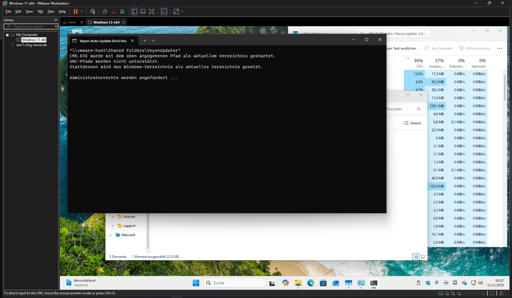
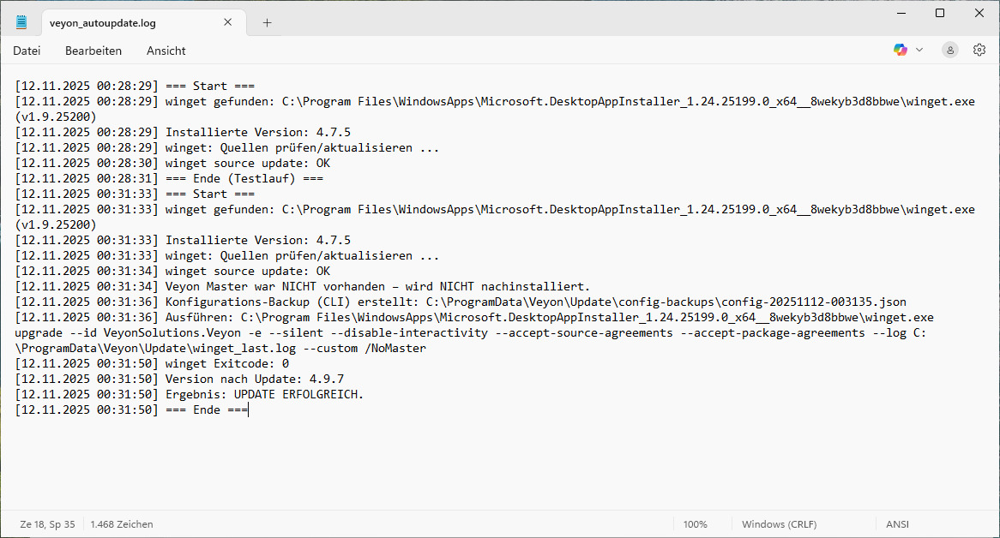

# Veyon Auto-Update (WinGet)

[](https://github.com/Railsimulatornet/VeyonAutoupdateforWindows/actions/workflows/powershell-validation.yml)
[](LICENSE)

[Deutsch](#deutsch) · [English](#english)

## Deutsch

Automatische Veyon-Updates über **WinGet** auf Windows-Geräten. Der Installer richtet eine geplante Aufgabe als **SYSTEM** ein. Sie startet mit etwa zwei Minuten Verzögerung beim Systemstart oder, bei aktiviertem Windows-Schnellstart, bei der Benutzeranmeldung.

Diese Anleitung beschreibt den veröffentlichten Stand **V1.3**. Für die Einrichtung werden Administratorrechte benötigt; die späteren automatischen Läufe benötigen keine Administratoranmeldung des Benutzers.

### Funktionen

- Versionsprüfung für das WinGet-Paket `VeyonSolutions.Veyon` und unbeaufsichtigtes Upgrade.
- Bei ermittelbaren Versionsnummern wird nur aktualisiert, wenn die Online-Version neuer ist als die installierte Version.
- Vor einem so erkannten Update wird die Veyon-Konfiguration gesichert: zunächst per CLI als JSON, bei Fehlschlag als Registry-Export.
- Ein zuvor nicht vorhandener Veyon Master wird durch den Installationsschalter `/NoMaster` beim Upgrade ausgelassen.
- Geplante Aufgabe mit etwa zwei Minuten Verzögerung; V1.3 erlaubt den Task auch im Akkubetrieb.
- Deutsches Laufprotokoll, WinGet-Log und automatische Rotation der Konfigurationssicherungen.

### Voraussetzungen

- Windows 10 oder Windows 11 mit Windows PowerShell und **App Installer / WinGet**.
- Eine bestehende Veyon-Installation; Veyon Master ist optional.
- Administratorrechte für Installation und Deinstallation des Updaters.
- Netzwerkzugriff auf die WinGet-Quelle und den Veyon-Download.

### Schnellstart: Setup-Datei

1. Öffne das [aktuelle Release](https://github.com/Railsimulatornet/VeyonAutoupdateforWindows/releases/latest) und lade die Setup-Datei herunter. Für V1.3 heißt sie **`VeyonUpdater_v1.3_Setup.exe`**.
2. Starte die Datei und bestätige die Administratorabfrage. Falls erforderlich, verwende **Als Administrator ausführen**.
3. Folge dem Setup. Es entpackt die Dateien und richtet den Updater ein.
4. Prüfe danach in der Windows-Aufgabenplanung die Aufgabe **`Veyon AutoUpdate (winget)`** und das Log unter `C:\ProgramData\Veyon\Update\`.

Die Setup-Datei ist der einfache Installationsweg, zum Beispiel für Eltern- oder Schülergeräte.

#### Alternative: ZIP-Paket

1. Lade die ZIP aus dem [aktuellen Release](https://github.com/Railsimulatornet/VeyonAutoupdateforWindows/releases/latest), für V1.3 **`VeyonUpdater_v1.3.zip`**.
2. Entpacke sie vollständig über **Alle extrahieren**. Starte den Installer aus dem entpackten Ordner.
3. Führe `Install-Veyon-AutoUpdate.cmd` als Administrator aus. Die CMD-Dateien und `Veyon-AutoUpdate.ps1` müssen im selben Ordner liegen.

Der Installer kopiert das PowerShell-Skript nach `C:\ProgramData\Veyon\Update\`, richtet den Task ein und startet eine Versionsprüfung mit `-Testlauf`. Dieser Test führt kein Veyon-Upgrade und keinen Konfigurationsexport aus.

### Verhalten und Einstellungen

| Bereich | Verhalten von V1.3 |
|---|---|
| Taskname | `Veyon AutoUpdate (winget)` |
| Benutzerkonto | `SYSTEM` |
| Trigger | Systemstart; bei erkanntem Windows-Schnellstart Benutzeranmeldung |
| Verzögerung | Etwa zwei Minuten |
| Bekannte Versionen | Numerischer Vergleich; Upgrade nur bei neuerer Online-Version |
| WinGet-Aufruf | `upgrade --id VeyonSolutions.Veyon -e --silent --disable-interactivity` mit Zustimmungsflags für Paket und Quelle |
| Veyon Master | Wenn vorher nicht vorhanden, wird `--custom /NoMaster` ergänzt |
| Konfigurationssicherungen | Unter `config-backups`; bis zu drei JSON-Dateien und drei Registry-Dateien, getrennt rotiert |

**Versions-Fallback in V1.3:** Kann das Skript weder die lokale noch die Online-Version ermitteln, versucht es trotzdem ein WinGet-Upgrade. Dieser Fallback erstellt vorher keinen Konfigurationsexport. Prüfe bei unbekannten Versionsangaben das Laufprotokoll.

Das Skript legt keine eigenen Veyon-Einstellungen fest. Die gesicherten JSON- beziehungsweise Registry-Dateien stehen für eine manuelle Wiederherstellung zur Verfügung.

#### Windows-Schnellstart

Der Installer prüft `HiberbootEnabled`. Bei aktiviertem Schnellstart wählt er **Benutzeranmeldung**, sonst **Systemstart**. So wird der automatische Lauf auch für die im Installer berücksichtigte Hybrid-Startkonfiguration eingerichtet. Den tatsächlich gewählten Trigger siehst du in der Aufgabenplanung.

### Protokolle und Prüflauf

| Datei / Ordner | Inhalt |
|---|---|
| `C:\ProgramData\Veyon\Update\veyon_autoupdate.log` | Ablauf, ermittelte Versionen und Exitcodes |
| `C:\ProgramData\Veyon\Update\winget_last.log` | WinGet-Protokoll des Upgrade-Aufrufs |
| `C:\ProgramData\Veyon\Update\config-backups\` | Konfigurationssicherungen |

Das Laufprotokoll verwendet deutsche Datumsangaben. Ab etwa 1 MB wird es gekürzt; bei vorhandenem Startmarker bleibt der letzte Lauf erhalten.

Einen Prüflauf kannst du in einer PowerShell mit Administratorrechten starten:

```powershell
powershell.exe -NoProfile -ExecutionPolicy Bypass -File "C:\ProgramData\Veyon\Update\Veyon-AutoUpdate.ps1" -Testlauf
```

Auch der Prüflauf aktualisiert die WinGet-Quellen und kann sie bei Fehlern zurücksetzen. Er führt kein Veyon-Upgrade aus. Ist WinGet im Ausführungskontext nicht verfügbar, beendet sich das Skript mit einem Logeintrag. Prüfe in diesem Fall App Installer / WinGet.

### Aktualisierung und Deinstallation

Für ein Update des Updaters führe das neuere Setup oder die entpackte `Install-Veyon-AutoUpdate.cmd` erneut als Administrator aus. Der Installer ersetzt das Skript und erstellt die geplante Aufgabe neu.

Zur Deinstallation führst du `Remove-Veyon-AutoUpdate.cmd` als Administrator aus. Sie entfernt den Task und den Ordner `C:\ProgramData\Veyon\Update\` einschließlich Logs und Konfigurationssicherungen. Kopiere benötigte Sicherungen vorher an einen anderen Ort. Die Veyon-Anwendung wird durch diese CMD-Datei nicht deinstalliert.

### Screenshots

Die Bilder zeigen die deutsche Windows-Oberfläche.



[Schritt 2: Einrichtung](Screens/VeyonUpdaterSchritt2.jpg) · [Schritt 3: Abschluss](Screens/VeyonUpdaterSchritt3.jpg)



### Projektstruktur und Dokumentation

| Datei | Aufgabe |
|---|---|
| [Install-Veyon-AutoUpdate.cmd](Install-Veyon-AutoUpdate.cmd) | Dateien kopieren, Task anlegen und Prüflauf starten |
| [Veyon-AutoUpdate.ps1](Veyon-AutoUpdate.ps1) | Versionsprüfung, Konfigurationssicherung und Upgrade |
| [Remove-Veyon-AutoUpdate.cmd](Remove-Veyon-AutoUpdate.cmd) | Updater und Task entfernen |
| [Screens/](Screens/) | Screenshots |
| [TERMS.md](TERMS.md) | Lizenz- und Nutzungshinweise |

### Versionsverlauf

| Version | Datum | Änderung |
|---|---|---|
| V1.3 | 21.02.2026 | Erstellung der geplanten Aufgabe überarbeitet; Ausführung auch im Akkubetrieb |
| V1.2 | 30.01.2026 | Setup als EXE-Datei ergänzt und Installation vereinfacht |
| V1.1 | 24.01.2026 | Installation stabilisiert und Hinweise zum Entpacken ergänzt |
| V1.0 | 12.11.2025 | Erste Veröffentlichung mit SYSTEM-Task, Startverzögerung und Logging |

### Fehlersuche

| Frage / Problem | Vorgehen |
|---|---|
| Zugriff verweigert oder Begleitdateien fehlen | ZIP vollständig entpacken und CMD als Administrator starten |
| Nach dem Einschalten passiert nichts | Trigger in der Aufgabenplanung prüfen; bei Schnellstart wird Benutzeranmeldung verwendet |
| Keine aktuelle Version ermittelt | Netzwerk, WinGet-Quelle und Laufprotokoll prüfen |
| PC während eines Upgrades ausgeschaltet | Beim nächsten Trigger läuft die Prüfung erneut; danach installierte Version und Log kontrollieren |
| WinGet fehlt | App Installer / WinGet auf dem Gerät prüfen und bei Bedarf aktualisieren |

### Lizenz und Nutzung

[MIT-Lizenz](LICENSE), ergänzt durch die [Nutzungshinweise](TERMS.md). Die Nutzung erfolgt auf eigene Verantwortung; halte aktuelle Sicherungen bereit. Roman Glos / Railsimulatornet.

## English

Automatic Veyon updates through **WinGet** on Windows devices. The installer creates a scheduled task running as **SYSTEM**. It starts about two minutes after system startup or, when Windows Fast Startup is enabled, after user logon.

This guide describes the published **V1.3** version. Setup requires administrator privileges; subsequent automatic runs do not require the user to sign in as an administrator.

### Features

- Version checks for the WinGet package `VeyonSolutions.Veyon` and unattended upgrades.
- When both version numbers can be determined, an upgrade runs only if the online version is newer than the installed version.
- Before such a detected update, the Veyon configuration is backed up: first as JSON through the CLI, with a registry export as fallback.
- If Veyon Master was not installed, the `/NoMaster` installer switch omits it during the upgrade.
- Scheduled task with about two minutes of delay; V1.3 also permits the task to run on battery power.
- German runtime logging, a WinGet log and automatic rotation of configuration backups.

### Requirements

- Windows 10 or Windows 11 with Windows PowerShell and **App Installer / WinGet**.
- An existing Veyon installation; Veyon Master is optional.
- Administrator privileges to install or remove the updater.
- Network access to the WinGet source and Veyon download.

### Quick start: setup executable

1. Open the [latest release](https://github.com/Railsimulatornet/VeyonAutoupdateforWindows/releases/latest) and download the setup executable. For V1.3, it is named **`VeyonUpdater_v1.3_Setup.exe`**.
2. Run the file and accept the administrator prompt. Use **Run as administrator** if needed.
3. Follow the setup. It extracts the files and installs the updater.
4. Check the **`Veyon AutoUpdate (winget)`** task in Windows Task Scheduler and the log under `C:\ProgramData\Veyon\Update\`.

The setup executable provides the straightforward installation route, for example on parent or student devices.

#### Alternative: ZIP package

1. Download the ZIP from the [latest release](https://github.com/Railsimulatornet/VeyonAutoupdateforWindows/releases/latest); for V1.3, use **`VeyonUpdater_v1.3.zip`**.
2. Fully extract it with **Extract All**. Start the installer from the extracted folder.
3. Run `Install-Veyon-AutoUpdate.cmd` as administrator. The CMD files and `Veyon-AutoUpdate.ps1` must be in the same folder.

The installer copies the PowerShell script to `C:\ProgramData\Veyon\Update\`, creates the task and starts a version check with `-Testlauf`. This test performs no Veyon upgrade or configuration export.

### Behaviour and settings

| Area | V1.3 behaviour |
|---|---|
| Task name | `Veyon AutoUpdate (winget)` |
| Account | `SYSTEM` |
| Trigger | System startup; user logon when Windows Fast Startup is detected |
| Delay | About two minutes |
| Known versions | Numeric comparison; upgrade only when the online version is newer |
| WinGet command | `upgrade --id VeyonSolutions.Veyon -e --silent --disable-interactivity` with package and source agreement flags |
| Veyon Master | Adds `--custom /NoMaster` if Master was not previously installed |
| Configuration backups | In `config-backups`; up to three JSON files and three registry files, rotated separately |

**Version fallback in V1.3:** If neither the installed nor the online version can be determined, the script still attempts a WinGet upgrade. This fallback does not create a configuration export beforehand. Check the runtime log when version information is unknown.

The script does not define its own Veyon settings. The saved JSON or registry files are available for manual recovery.

#### Windows Fast Startup

The installer checks `HiberbootEnabled`. It selects **user logon** when Fast Startup is enabled and **system startup** otherwise. This configures the automatic run for the hybrid startup setting handled by the installer. Check Task Scheduler to see the trigger selected on your device.

### Logs and test run

| File / folder | Content |
|---|---|
| `C:\ProgramData\Veyon\Update\veyon_autoupdate.log` | Execution details, detected versions and exit codes |
| `C:\ProgramData\Veyon\Update\winget_last.log` | WinGet log from the upgrade command |
| `C:\ProgramData\Veyon\Update\config-backups\` | Configuration backups |

The runtime log uses German date formatting. It is trimmed above approximately 1 MB; when a start marker exists, the most recent run is kept.

To start a test run from an elevated PowerShell:

```powershell
powershell.exe -NoProfile -ExecutionPolicy Bypass -File "C:\ProgramData\Veyon\Update\Veyon-AutoUpdate.ps1" -Testlauf
```

The test run also updates WinGet sources and may reset them on errors. It does not upgrade Veyon. If WinGet is unavailable in the execution context, the script stops and writes a log entry. Check App Installer / WinGet in that case.

### Updates and removal

To update the updater, run the newer setup executable or the extracted `Install-Veyon-AutoUpdate.cmd` again as administrator. The installer replaces the script and recreates the scheduled task.

To uninstall, run `Remove-Veyon-AutoUpdate.cmd` as administrator. It removes the task and the `C:\ProgramData\Veyon\Update\` folder, including logs and configuration backups. Copy any backups you need to another location first. This CMD file does not uninstall the Veyon application.

### Screenshots

These images show the German Windows interface.


[Step 2: setup](Screens/VeyonUpdaterSchritt2.jpg) · [Step 3: completion](Screens/VeyonUpdaterSchritt3.jpg)


### Project structure and documentation

| File | Purpose |
|---|---|
| [Install-Veyon-AutoUpdate.cmd](Install-Veyon-AutoUpdate.cmd) | Copy files, create the task and run the version check |
| [Veyon-AutoUpdate.ps1](Veyon-AutoUpdate.ps1) | Version checks, configuration backup and upgrade |
| [Remove-Veyon-AutoUpdate.cmd](Remove-Veyon-AutoUpdate.cmd) | Remove the updater and task |
| [Screens/](Screens/) | Screenshots |
| [TERMS.md](TERMS.md) | License and usage notes |

### Version history

| Version | Date | Change |
|---|---|---|
| V1.3 | 2026-02-21 | Revised scheduled task creation; operation on battery power |
| V1.2 | 2026-01-30 | Added an EXE setup and simplified installation |
| V1.1 | 2026-01-24 | Improved installation stability and extraction instructions |
| V1.0 | 2025-11-12 | First release with SYSTEM task, startup delay and logging |

### Troubleshooting

| Question / problem | Action |
|---|---|
| Access denied or companion files missing | Fully extract the ZIP and run the CMD as administrator |
| Nothing happens after powering on | Check the Task Scheduler trigger; Fast Startup uses user logon |
| Current version cannot be determined | Check networking, the WinGet source and runtime log |
| PC switched off during an upgrade | The next trigger runs the check again; then check the installed version and log |
| WinGet missing | Check App Installer / WinGet on the device and update it if necessary |

### License and usage

[MIT License](LICENSE), with additional [usage notes](TERMS.md). Use at your own risk and maintain current backups. Roman Glos / Railsimulatornet.
